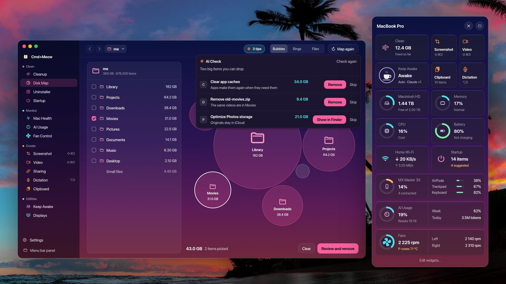

<p align="center">
  
</p>

<h1 align="center">Cmd+Meow</h1>

<p align="center">
  <b>Everything your Mac needs. Free.</b><br>
  A cleaner, screenshots, screen recording, clipboard history, dictation and system monitors in one menu bar app. Open source, no account.
</p>

<p align="center">
  <a href="https://github.com/romanfurman6/cmdmeow/releases/latest/download/CmdMeow.dmg"></a>
</p>

<p align="center">
  <a href="https://github.com/romanfurman6/cmdmeow/releases/latest"></a>
  
  
  <a href="LICENSE"></a>
  <a href="https://github.com/romanfurman6/cmdmeow/actions/workflows/macos.yml"></a>
</p>

<p align="center">
  <a href="https://cmdmeow.com">Website</a> ·
  <a href="https://cmdmeow.com/#watch">▶ How it works (0:27)</a> ·
  <a href="https://github.com/romanfurman6/cmdmeow/releases">Releases</a>
</p>



## Install

Download [CmdMeow.dmg](https://github.com/romanfurman6/cmdmeow/releases/latest/download/CmdMeow.dmg) and drag Cmd+Meow to Applications. You only grant permissions for the tools you turn on.

The app is signed and notarized. It needs macOS 13 or later. It runs on Intel Macs too, but Displays and the power readings in Mac Health need Apple silicon.

## Clean

See what takes up space and remove it. You review the list first, and removed files go to the Trash.

- **Cleanup** finds caches, logs, old installers and leftovers.
- **Disk Map** shows folders as bubbles you can open one level at a time.
- **Uninstaller** removes an app and the files it leaves behind.
- **Startup** lists login items and background apps that start with your Mac, and marks the ones you likely don't need.


## Monitor

- **Mac Health** shows CPU, memory, disk, battery, Wi-Fi speed and the batteries of your AirPods, mouse and keyboard.
- **AI Usage** shows your limits, how fast you use them and the cost for Claude, Codex, Gemini and OpenCode.
- **Fan Control** shows fan speeds and temperatures, and lets you set a fixed speed or your own curve.


## Create

- **Screenshot** captures an area, a window or the whole screen, then opens an editor with arrows, blur, text and zoom.
- **Video** records the screen with camera, mic and system audio.
- **Sharing** uploads a screenshot or a recording to your own storage and copies the link.
- **Dictation** types what you say at the cursor. Press ⌥D to start. Audio stays on your Mac.
- **Clipboard** keeps what you copy, with search, pins and quick paste.


### Set up Sharing

Sharing uploads to your own storage, Cloudflare R2 or any S3-compatible service. You set it up once.

You need a free [Cloudflare](https://dash.cloudflare.com/sign-up) account. R2 gives 10 GB free and doesn't charge for downloads. With the Claude desktop app, Claude does the setup for you. Without it, Claude opens in your browser and walks you through the same steps, then tells you what goes in each field of the Sharing page.

1. In Cmd+Meow, open **Sharing** in the sidebar (under Create).
2. Press **Ask Claude to set up**. Claude opens with the instructions already typed in. Press Send.
3. Sign in to Cloudflare when Claude asks. If R2 asks you to accept its plan, do that yourself. Claude never types payment details.
4. Wait while Claude creates the bucket, turns on public links, adds the CORS rule and makes an access key for this bucket only.
5. Open `cmdmeow-sharing.cmdmeow` from Downloads. Cmd+Meow asks "Use this storage for sharing?". Confirm it.
6. Take a screenshot and press **Share** in the editor. The link is now on your clipboard.

Cmd+Meow keeps the secret key in your Keychain and moves the `.cmdmeow` file to the Trash. Claude never writes the keys into the chat.

<details>
<summary>Set it up by hand, or use other S3 storage</summary>

Fill in these fields on the Sharing page:

| Field | Cloudflare R2 example |
| --- | --- |
| Endpoint | `<account id>.r2.cloudflarestorage.com` |
| Bucket | `cmdmeow-shares` |
| Access key, Secret key | from an R2 API token with Object Read & Write on this bucket |
| Public URL | `https://pub-….r2.dev`, or your own domain |

Any S3-compatible storage works. Turn on public read for the bucket so links open in a browser.

</details>

## Utilities

- **Keep Awake** stops your Mac from sleeping. Auto does it only while an AI agent is working.
- **Displays** sets the brightness and volume of external monitors from your keyboard.

## Panel and themes

Click the cat in the menu bar to open the panel. It's a grid of widgets you arrange yourself. Turn off any tool you don't use. The default theme is Dark Miami, and you can switch to Light Classic or Dark Classic in Settings › General.


## What it replaces

CleanMyMac, DaisyDisk, CleanShot X, Loom, Paste, iStat Menus, Wispr Flow and Amphetamine each do one of these jobs. Cmd+Meow does all of them for free.

<sub>CleanMyMac, DaisyDisk, CleanShot X, Loom, Paste, iStat Menus, Wispr Flow and Amphetamine are trademarks of their owners. Cmd+Meow is not affiliated with them.</sub>

## Planned

- Clipboard popup on ⇧⌘V in any app
- A live cat in the menu bar
- Keyboard lock for cleaning
- Quick notes in the panel

## Automation

These actions have links you can open from a script, Raycast or Shortcuts. For example, `open cmdmeow://awake/toggle`. The Dev build uses `cmdmeow-dev://`.

| Link | What it does |
| --- | --- |
| `awake/on`, `awake/auto`, `awake/off`, `awake/toggle` | Switch Keep Awake |
| `capture/area`, `window`, `screen`, `delayed`, `text`, `color`, `ruler`, `record`, `history` | Take a screenshot or record |
| `dictation/toggle`, `start`, `stop`, `cancel` | Start or stop Dictation |
| `cat/purr`, `hiss`, `hungry`, `eat`, `hello` | Make the cat react |
| `open/<tool>[/<page>]`, e.g. `open/disk-map`, `open/capture/settings`, `open/settings` | Open a page |
| `open/window` | Open the window |

## Privacy and safety

- No account and no tracking. Files, clipboard, recordings and dictation stay on your Mac unless you share them.
- Cmd+Meow encrypts clipboard and dictation history on disk with XChaCha20-Poly1305 and keeps the key in your Keychain. Clipboard doesn't save passwords from password managers, or tokens, keys and card numbers you copy.
- Crash reports are off until you turn them on. Setup asks once, and you can change it in Settings › General. A report holds the error, stack trace, app version and macOS version, and goes to Sentry. It has no files, hostname or IP address, and your home folder shows as `~`. Builds from source never send anything.
- Cleanup never reads file contents. If you turn on AI Check, only file paths, sizes and ages go to Claude.
- Cmd+Meow never removes Documents, Desktop, Projects, Keychains, `.ssh` or any folder with `.git`.
- Removed items go to the Trash unless you choose "Delete right away".
- Settings › General › **Remove Cmd+Meow** deletes the app with its data, Keychain items, permissions, fan helper and login item. Screenshots and recordings in your own folders stay.

## Development

- macOS (uses AppKit for the glass material and menu bar behavior)
- Rust stable (edition 2021)
- Optional: [Claude Code CLI](https://docs.anthropic.com/en/docs/claude-code) signed in, for Claude limits in AI Usage and AI Check in Cleanup

```bash
git clone https://github.com/romanfurman6/cmdmeow
cd cmdmeow
cargo run --release            # menu bar app
cargo test                     # unit tests
```

```bash
scripts/bundle-mac.sh              # target/bundle/CmdMeow.app + .zip
UNIVERSAL=1 scripts/bundle-mac.sh  # Apple silicon + Intel
```

CI (`.github/workflows/macos.yml`) runs the tests and builds a universal
`CmdMeow.app` on every push and PR. Download it from the run's
**Artifacts**.

<details>
<summary><b>Releases, signing and notarization</b></summary>

Versions follow semver. The version is set in `Cargo.toml`. Info.plist gets
it as `CFBundleShortVersionString` and the commit count as `CFBundleVersion`.
Settings › General shows both ("Cmd+Meow 0.2.0 (57)").

```sh
scripts/release.sh patch   # or minor, major, or an exact 0.2.0
```

Run it on a clean, up-to-date `main`, with `gh` signed in. It bumps the
version on a `release/vX.Y.Z` branch and merges it through a PR, because
`main` takes no direct pushes. Then it tags the merged commit `vX.Y.Z` and
pushes the tag. After that:

1. The tag starts `.github/workflows/release.yml` on the M1 runner. The job
   runs in the protected **`release`** environment and waits.
2. GitHub asks Roman to approve. Open the run › **Review deployments** ›
   tick `release` › **Approve and deploy**. The job gets the signing secrets
   only after that.
3. Tests, universal build, sign, notarize, then a GitHub Release with
   generated notes and `CmdMeow.dmg`, `CmdMeow.zip`, `SHA256SUMS.txt`,
   `latest.json`.

The asset names never change, so
`https://github.com/romanfurman6/cmdmeow/releases/latest/download/CmdMeow.zip`
always points to the newest version. In-app updates download it.

#### In-app updates

`latest.json` holds the version, this tag's zip URL and its sha256. The app
reads `releases/latest/download/latest.json` 15 s after launch and every 6 h.
A newer version shows a banner in the panel. **Update** downloads the zip and
checks the sha256, the code signature, the bundle id and the version. Then it
swaps the app and relaunches. The code is in `src/kit/update.rs`. Publishing
the Release is the whole rollout. Tags with a `-` (`v0.2.0-beta.1`) are
prereleases, and the app never offers them. Test locally with
`CMDMEOW_UPDATE_URL=file:///path/latest.json` (works in the dev build too).

#### Signing and notarization

Release builds are signed with **Developer ID Application** and notarized with
these secrets. They are **environment secrets of `release`** (Settings ›
Environments › release), not repository secrets, so no other workflow can use
them. The environment requires Roman's approval, allows only `v*` tags, and
admins can't bypass it. Without the secrets the release is ad-hoc signed and
users must right-click › Open.

| Secret | Value |
| --- | --- |
| `MACOS_CERT_P12` | `base64 -i DeveloperID.p12` (certificate + private key) |
| `MACOS_CERT_PASSWORD` | password of that .p12 |
| `NOTARY_KEY_P8` | contents of the App Store Connect API key `AuthKey_XXXX.p8` |
| `NOTARY_KEY_ID` | that key's Key ID |
| `NOTARY_ISSUER_ID` | Issuer ID from App Store Connect › Users and Access › Integrations |
| `SENTRY_DSN` | Sentry project DSN for crash reports (Project Settings › Client Keys). Compiled into release builds only |

The signed app runs with the hardened runtime and `assets/CmdMeow.entitlements`
(microphone, camera, Apple Events).

Releases from 0.2.0 on are notarized. If notarization fails (it did for 0.1.0
and 0.1.1 while Apple set up the developer account), `release.yml` still
publishes the Developer ID signed build and the release name says
"(not notarized)".

CleanMeBro was the old name. The bundle id is now `com.romanfurman6.cmdmeow`,
so macOS treats Cmd+Meow as a new app. Grant
Screen Recording, Accessibility and Full Disk Access again, turn **Open at
login** back on, and delete the old app. Settings, clipboard history and the
sharing key move over on first launch. The fan helper keeps its old id, so an
installed helper keeps working.

The icon artwork is `assets/icon/AppIcon-art.png`. To regenerate
`assets/AppIcon.icns`, run `pip install pillow`, then
`python3 scripts/make-icon.py`. The menu bar
icon is drawn from vector paths in `src/kit/brand.rs`.

</details>

<details>
<summary><b>Test and preview modes</b></summary>

```bash
# Read-only Cleanup check: prints what would be offered, removes nothing
cargo run --release -- --scan-report
cargo run --release -- --scan-report --ai     # also run AI Check

# Render a view with sample data to a PNG and exit
cargo run --release -- --screenshot out.png --view panel
```

`--view` values: `panel`, `customize` (Settings › Widgets), `settings-tools`,
`storage`, `memory`, `battery`, `cpu`, `network`, `devices` (Mac Health with that card's details), `claude-detail` (AI Usage with the limits popup),
`cleanup`, `results`, `lens`, `lens-live`, `claude`, `clipboard`,
`clipboard-settings`, `clipboard-quick`, `clipboard-list`.

</details>

<details>
<summary><b>Architecture</b></summary>

The app is a small **core** (the shell) plus independent **tools**. Each tool
is one folder under `src/tools/` and implements the `Tool` trait
(`src/core/tool.rs`). A tool can offer any of: panel widgets,
a page in the full window, recommendations and the menu-bar title.

- Tools never import each other (a test enforces it). To link to another
  tool, a tool asks the core by id, for example
  `cx.open_page("cleanup", "claude")`. If that tool isn't installed, nothing
  happens.
- Shared code lives in `src/kit/` and doesn't depend on any tool.
- The panel lays widgets out on a 4-column grid: each widget spans 1, 2 or 4
  columns and reports its own height. The panel grows with its widgets and
  scrolls when it gets taller than the screen.

#### Adding a tool

1. Create `src/tools/<name>/mod.rs` with a struct implementing `Tool`
   (`id`, `name`, `badge` are required; everything else is optional).
2. Add one line to `all()` in `src/tools/mod.rs`.

Its widgets appear in the gallery of **Settings › Widgets**, it gets an
on/off switch in **Settings › Tools**, and if it has a page it gets a sidebar
entry. Nothing in `src/core/` changes.

</details>

<details>
<summary><b>Project layout</b></summary>

```
cmdmeow/
├── Cargo.toml / Cargo.lock
├── src/
│   ├── main.rs              entry point, CLI flags
│   ├── core/                the shell; knows tools only through the trait
│   │   ├── tool.rs          Tool trait, widget specs, actions, Cx
│   │   ├── shell.rs         tray icon, panel ⇄ full window, actions, screenshots
│   │   ├── panel.rs         widget grid, recommendation, footer, Open button
│   │   ├── editor.rs        Settings: drag-and-drop widget editor, tools on/off
│   │   ├── window.rs        full window: sidebar of tool pages and Settings
│   │   ├── layout.rs        4-column widget packing
│   │   └── settings.rs      saved widget order, visibility and tools turned off
│   ├── kit/                 shared by all tools
│   │   ├── glass.rs         drawing kit: glass cards, gradients, glows, vector icons
│   │   ├── brand.rs         the Cmd+Meow mark as vector paths (menu bar icon)
│   │   ├── controls.rs      shared page controls (round action button)
│   │   ├── native.rs        macOS: glass material, menu-bar app, thermal state, Trash
│   │   ├── fs.rs            folder sizes, protected paths, move to Trash, disk space
│   │   ├── claude_code.rs   Claude Code CLI and project discovery
│   │   ├── ai/              AI usage providers and API prices
│   │   └── mechanics.rs     numbers/thresholds from docs/MECHANICS.md
│   └── tools/
│       ├── mod.rs           the tool list (the only place that names tools)
│       ├── system/          Mac Health: readings, widgets, details popups
│       ├── cleanup/         junk rules, AI Check, removal, --scan-report
│       ├── lens/            Disk Map: folder measuring and live bubbles
│       ├── uninstaller/     apps, leftovers, drop-to-uninstall widget
│       ├── startup/         login items, launch agents and daemons
│       ├── capture/         Screenshot, Video and Sharing (one engine, three tools)
│       ├── dictation/       speech to text at the caret
│       ├── clipboard/       clipboard history and quick paste
│       ├── fan/             fan speeds, temperatures, helper
│       ├── keep_awake/      keep your Mac awake: Off, Auto (AI agents) or On
│       ├── displays/        brightness and volume of external displays
│       └── claude/          AI Usage: usage of Claude, Codex, Gemini, OpenCode
├── vendor/eframe/        eframe 0.37 with one patch (see Cargo.toml)
├── docs/
│   ├── images/          README images
│   ├── MECHANICS.md     rules, thresholds and where each came from
│   └── mechanics.json   same data, machine-readable
├── assets/
│   ├── AppIcon.icns     app icon, all sizes (generated)
│   └── icon/AppIcon-art.png icon artwork
├── scripts/
│   ├── bundle-mac.sh    build CmdMeow.app + zip
│   └── make-icon.py     artwork → AppIcon.icns
└── .github/workflows/macos.yml   CI: test, build, upload the app
```

The screenshots in `docs/images/` are rendered from sample data with
`CMDMEOW_THEME=light|dark|miami` and `--screenshot <file.png> --view <name>`,
then placed on the website's desktop pictures (`site/desk*.jpg`).

</details>

## License

MIT, see [LICENSE](LICENSE).
